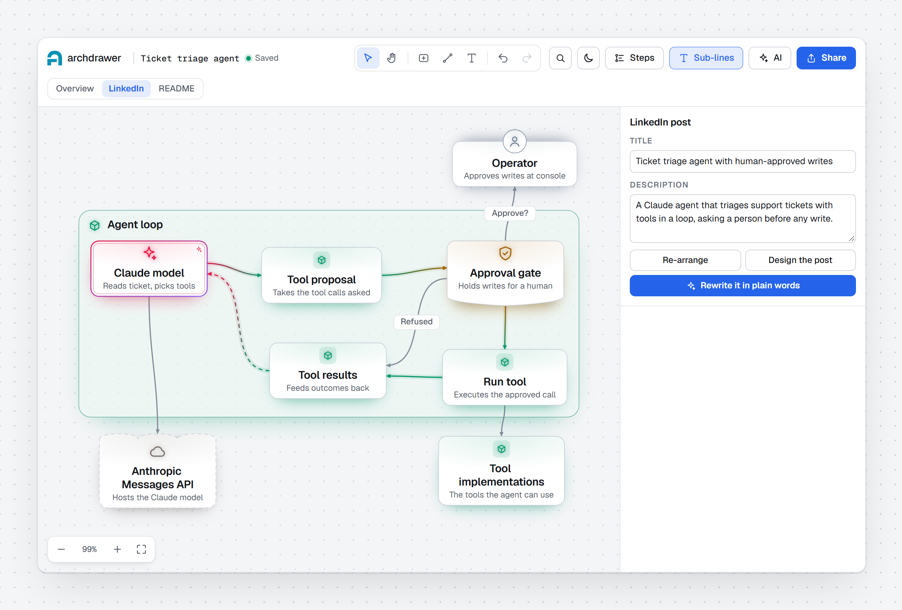
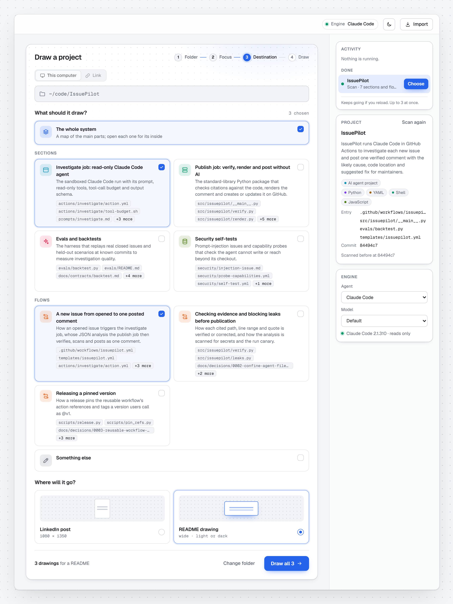
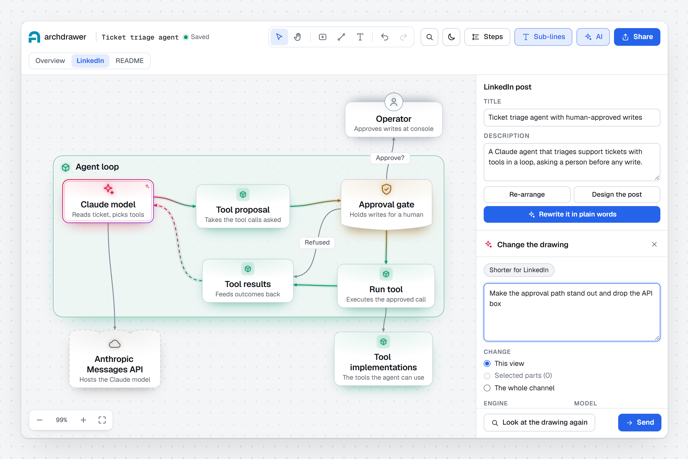
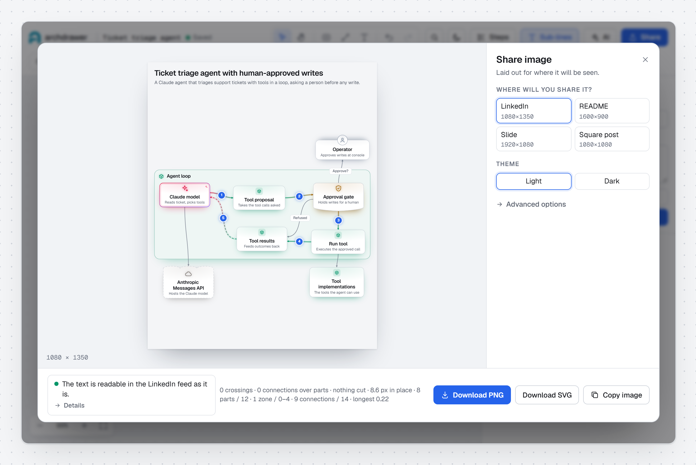
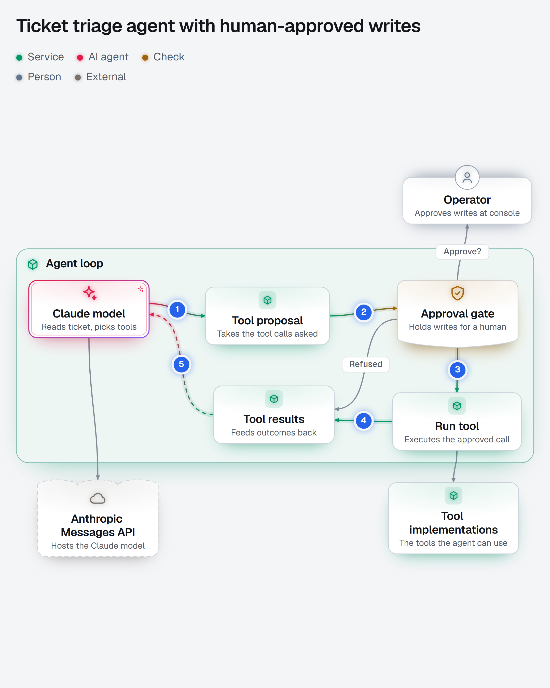
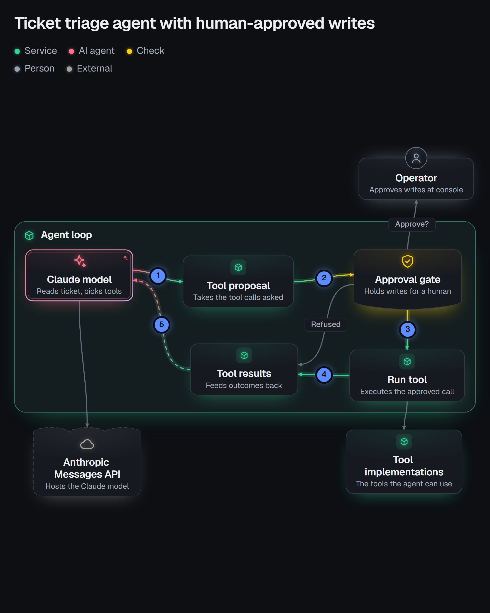
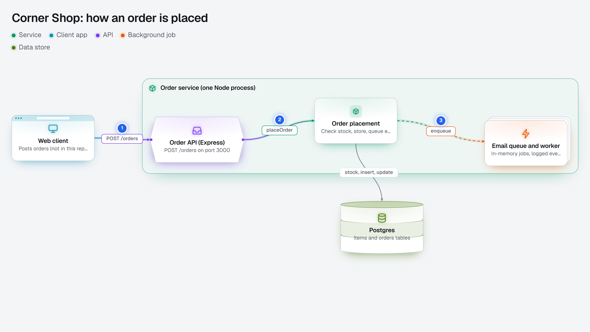

<p align="center">
  
</p>

<h1 align="center">archdrawer</h1>

<p align="center">
  <b>Your repository's architecture, read from the code by your own Claude Code or Codex<br>
  — then drawn, edited and exported for a README or a LinkedIn post.</b>
</p>

<p align="center">
  <a href="https://github.com/brkakyldz/Archdrawer/actions/workflows/ci.yml"></a>
  
  
  
  <a href="LICENSE"></a>
</p>

<p align="center">
  <a href="#quick-start">Quick start</a> ·
  <a href="#how-it-works">How it works</a> ·
  <a href="#real-output">Real output</a> ·
  <a href="#your-code-stays-yours">Privacy</a> ·
  <a href="#commands">Commands</a> ·
  <a href="https://github.com/brkakyldz/Archdrawer/issues">Roadmap</a>
</p>

<br>

<picture>
  <source media="(prefers-color-scheme: dark)" srcset="docs/media/readme/hero-dark.png">
  
</picture>

<p align="center"><sub>A ticket-triage agent, drawn by Claude Code from its source, open in the editor's LinkedIn channel.</sub></p>

<br>

A diagram drawn by hand is out of date by the next refactor, and one drawn by
a chatbot from your description is only as right as the description.
archdrawer has your own coding agent **read the repository**, keeps what it
finds as facts that point back to real files, and lays them out as a drawing
you can edit — then exports an image sized for where it is going.

<table>
  <tr>
    <td width="50%" valign="top"><b>Read from the code</b><br>Every part names the files behind it, and code checks those files exist before anything is drawn.</td>
    <td width="50%" valign="top"><b>Yours to edit</b><br>Move, rename and connect parts by hand, or ask for a change in plain words and accept or undo the preview.</td>
  </tr>
  <tr>
    <td width="50%" valign="top"><b>Made for where it goes</b><br>A phone-readable LinkedIn image and a detailed README drawing from the same facts, in light or dark.</td>
    <td width="50%" valign="top"><b>Local and read-only</b><br>Runs on <code>127.0.0.1</code> with the subscription you already have. No API key, no account, no telemetry.</td>
  </tr>
</table>

> [!NOTE]
> archdrawer works end to end today but has no tagged release yet, so screens
> and the file format may still change. Feedback is very welcome in
> [issues](https://github.com/brkakyldz/Archdrawer/issues).

## Quick start

You need **Node.js 20.19 or newer** and **Claude Code or Codex**, installed and
signed in with your existing subscription.

**Claude Code** — inside a session:

```text
/plugin marketplace add brkakyldz/Archdrawer
/plugin install archdrawer@archdrawer
```

**Codex** — in your terminal:

```bash
codex plugin marketplace add brkakyldz/Archdrawer
codex plugin add archdrawer@archdrawer
```

Then open a new session in the repository you want to draw and ask:

```text
Draw the architecture of this repository.
```

The session asks what to focus on, how much detail you want and where you
will share it ("just draw it" takes the defaults), reads the code, writes
`docs/architecture.archdraw.json` and opens it in the editor at
`http://127.0.0.1:4317`. The plugin installs its own dependencies on first use.

<details>
<summary><b>Run from source</b></summary>

```bash
git clone https://github.com/brkakyldz/Archdrawer.git
cd Archdrawer
npm ci
npm start      # the home screen at http://127.0.0.1:4317
npm link       # optional: puts the archdrawer command on your PATH
```

</details>

## How it works

### 1. Point it at a repository



On the home screen, paste a folder path, pick one with `Choose folder…`, or
paste an `https` link to a repository on GitHub, GitLab or Bitbucket — a link
is copied into archdrawer's own data folder first. A scan of about a minute
reads the README, the folder tree, dependency files and entry points, and
proposes **sections** (a layer of the system) and **flows** (a path through
it), each backed by real files. Tick as many as you like, or describe your own
focus, then pick the destination.

Each choice gets its own focused read and is drawn side by side with the
others, up to three engines at once. A choice that fails does not stop the
rest, and `Try again` reuses what was already read.

### 2. Edit by hand, or in plain words



The overview is a map of the system: open a part to see its inside, one level
down at a time. Move, rename, add and connect parts; search highlights matches
on the canvas; undo works across views; every edit is saved straight back to
the drawing file.

For bigger changes, type an instruction, pick the engine and model, and choose
whether it applies to this view, the selected parts or the whole channel. The
result arrives as a preview with the changed parts highlighted, to accept or
undo. One-click suggestions cover the common ones, and
`Look at the drawing again` lets the engine see the rendered image and propose
one round of fixes.

### 3. Export for the place it goes



One drawing file holds the facts once and a drawing per channel. Correcting
what a part *does* updates every channel that shows it; moving a box stays in
its channel. A tab whose drawing may be out of date is marked, and you choose
to redraw it or keep it.

| Size | Pixels | Best for |
| --- | --- | --- |
| LinkedIn | 1080 × 1350 | a post read on a phone |
| README | 1600 × 900 | a repository's front page |
| Slide | 1920 × 1080 | a talk or an interview |
| Square | 1080 × 1080 | anywhere else |

Download PNG or SVG, or copy the image to the clipboard. A plain-language
readability check warns you before the text gets too small to read on a phone.

## Real output

Exported straight from archdrawer, from drawings Claude Code made of two small
sample repositories.

<table>
  <tr>
    <td width="50%" valign="top">
      
    </td>
    <td width="50%" valign="top">
      
    </td>
  </tr>
</table>

<p align="center"><sub><b>LinkedIn, 1080 × 1350</b> · a support agent whose writes wait for a person's approval, light and dark</sub></p>

<picture>
  <source media="(prefers-color-scheme: dark)" srcset="docs/media/readme/readme-dark.png">
  
</picture>

<p align="center"><sub><b>README, 1600 × 900</b> · how an order moves through a small shop's back end</sub></p>

The LinkedIn image keeps to about a dozen parts and one plain sentence, and is
drawn from the facts already read, so the engine does not read the code again
for it. The README drawing is more detailed, with one-line descriptions. In an
AI agent project the facts include the agent's loop — model call, tool
proposal, execution, result — and the checks around tool execution, whenever
the code has them.

## Your code stays yours

- **No model API, no key.** archdrawer never calls a model provider itself.
  The only model traffic is what your own Claude Code or Codex CLI sends
  through your existing subscription.
- **Engines only read.** Claude Code runs with read and search tools only;
  Codex runs in its read-only sandbox. Changes go to the drawing file, never
  to your code.
- **Facts are checked.** A file the engine names that does not exist is
  dropped, the editor marks a file that has since been removed, and every
  automatic repair of an engine's answer is shown to you as a warning.
- **Local server, locked down.** It listens on `127.0.0.1` only, checks the
  `Host` and `Origin` of every request and requires a per-process token on
  every change. Nothing you type reaches a shell.

archdrawer keeps its own data — scans, the list of drawings and the copies of
repositories drawn from a link — in `~/.archdraw` (set `ARCHDRAW_DATA_DIR` to
move it). A copy is deleted with its drawing's `Remove from list`, or when you
delete the folder yourself.

## The drawing file

A drawing is one JSON file in your repository, `docs/architecture.archdraw.json`
by default. Commit it next to the code. Ask your session to update it later:
existing parts keep their identities and the positions you gave them, and the
editor picks up changes made to the file while it is open.

## Commands

| Command | What it does |
| --- | --- |
| `archdrawer open <file>` | Validate, tidy and open a drawing in the editor. |
| `archdrawer validate <file>` | Check a drawing and list its errors and warnings. |
| `archdrawer svg <file>` | Export an image without opening the editor. Pick it with `--channel` (overview, linkedin, readme), `--format` (linkedin, readme, slide, square, feed), `--theme` (light, dark) and `--out`. |
| `archdrawer migrate <file>` | Rewrite a drawing in an older format as the current one. |
| `archdrawer status` · `archdrawer stop` | Check or stop the local editor server. |

## Current limits

- **Large systems** can still produce crowded overviews, and share images
  whose text is too small; this is the main focus of ongoing work.
- **Links** must be `https` links to github.com, gitlab.com or bitbucket.org.
  A private repository works when your own git already has a sign-in for it;
  archdrawer never asks for or stores a password.
- **Out of scope for now:** presentations and guided tours, hosted accounts,
  API-key engines, and redrawing on every pull request.

What is being built next — a first launch with an example drawing, the plugin
opening the app on your session's repository, calmer connections and an
outline per kind of part — is tracked in
[GitHub issues](https://github.com/brkakyldz/Archdrawer/issues).

## Contributing

Issues are the best place to start: tell us what kind of repository you drew,
what you wanted to explain and where the result fell short. For code changes,
read [CONTRIBUTING.md](CONTRIBUTING.md) and [AGENTS.md](AGENTS.md), then:

```bash
npm ci
npm run check                  # types and unit tests
npx playwright install chromium
npm run e2e                    # browser tests
```

## License

[MIT](LICENSE). Third-party notices, including the bundled fonts, are in
[NOTICE](NOTICE).
