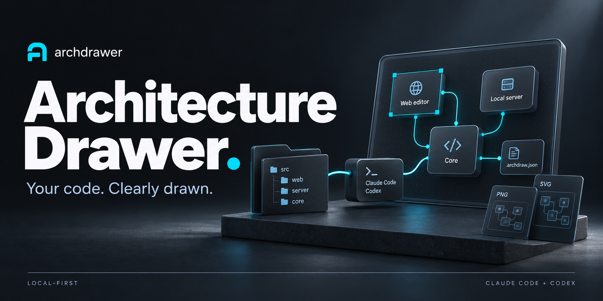
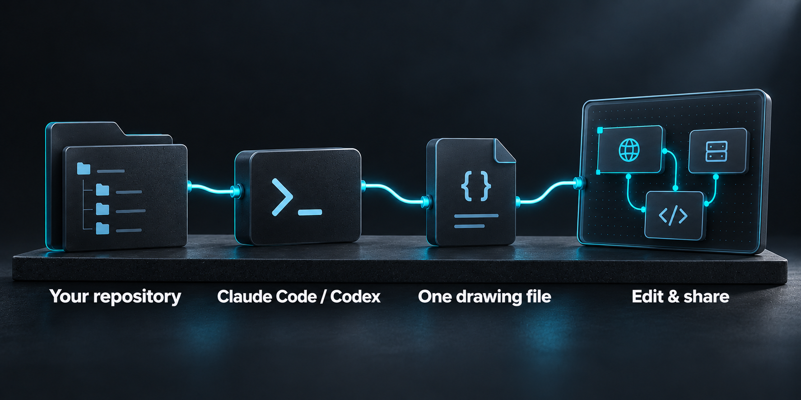
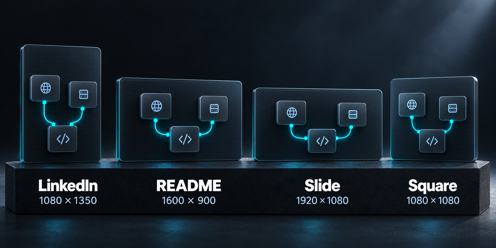

# archdrawer

**Under development — not yet released.**

**Get your project's architecture read from the code, ready to share.**

archdrawer turns a code repository into an editable architecture drawing.
Your own **Claude Code or Codex** session reads the code and creates the
drawing; a local browser editor helps you refine it and export an image for
a README, a LinkedIn post, a presentation or an interview.

It uses the subscription you already have. **Local-first. No API key.
Read-only code access.**

[Get started](#get-started) · [What works today](#what-works-today) ·
[Planned work](#planned-work) ·
[Feedback & issues](https://github.com/brkakyldz/Archdrawer/issues)

## From repository to drawing



1. **Ask your session.** Open Claude Code or Codex in your repository and ask:
   “Draw the architecture of this repository.” For a new drawing, the session
   asks what to focus on, how much detail you want and where you will share it.
   “Just draw it” uses the defaults.
2. **Read the code.** The session maps the real components and connections,
   writes `docs/architecture.archdraw.json` by default, validates it and opens
   the local editor.
3. **Make it yours.** Move and rename parts, add connections, open detail
   views or ask for a change in plain language. Autosave writes your edits
   straight back into the drawing file.
4. **Share it.** Choose a format and theme, then download PNG or SVG, or copy
   the image to your clipboard.

The drawing lives next to the code as one JSON file you can commit. Ask your
session to update it later; existing parts keep their identities and the
positions you chose.

## Get started

You need **Node.js 20.19 or newer**, plus Claude Code or Codex installed and
signed in with your existing subscription. Runs on **Windows, macOS and
Linux**.

### Claude Code

Run these commands inside Claude Code:

```text
/plugin marketplace add brkakyldz/Archdrawer
/plugin install archdrawer@archdrawer
```

### Codex

Run these commands in your terminal:

```bash
codex plugin marketplace add brkakyldz/Archdrawer
codex plugin add archdrawer@archdrawer
```

Start a new session in the repository you want to draw and ask:

```text
Draw the architecture of this repository.
```

The plugin launcher installs its runtime dependencies on first use. You can
also use a local clone's folder as the marketplace source.

<details>
<summary>Run from source</summary>

```bash
git clone https://github.com/brkakyldz/Archdrawer.git
cd Archdrawer
npm ci
npm link
```

This installs the `archdrawer` command. Install the plugin from this folder
to give your coding session the drawing instructions too.

To open an existing drawing:

```bash
archdrawer open docs/architecture.archdraw.json
```

</details>

## What works today

- **A drawing grounded in files.** Parts describe what they do and point to
  the code behind them. Groups and connections show how the system fits
  together; detail views open a part's internals one level down.
- **A local editor.** Move, rename and add parts and connections. Undo and
  redo changes, search across all views with matches highlighted on the
  canvas, and autosave to the drawing file. A breadcrumb shows where you are
  in the detail views.
- **Shared facts, one drawing per channel.** The file keeps the facts about
  your system once, plus a drawing for each channel: the overview and the
  LinkedIn post today, README and presentation next. Moving a box stays in its
  channel; correcting what a part does updates the facts and every channel
  that shows it, and a tab whose drawing may be out of date is marked
  “needs update”.
- **A LinkedIn post from the same facts.** The LinkedIn tab draws one image
  for a phone screen. Your engine tells the story from the facts already read,
  without reading the code again; with no engine, a simple version is laid
  out by code. Redraw it, or keep it, when the facts change.
- **AI changes with a scope.** Type an instruction, choose Claude Code or
  Codex and a model, then target the current view, selected parts or the
  whole channel.
- **Images ready to share.** Four presets, light and dark themes, PNG, SVG
  and clipboard copy, sized for the channel you are on.

## Made for where you share it



| Destination | Size |
| --- | --- |
| LinkedIn | 1080 × 1350 |
| README | 1600 × 900 |
| Slide | 1920 × 1080 |
| Square | 1080 × 1080 |

Choose a light or dark image, export as PNG or SVG, or copy it to your
clipboard. Share packages the drawing of the channel you are on; a
readability check flags problems before you download.

The illustrations in this README explain the workflow; they are not editor
screenshots.

## Your code stays under your control


archdrawer runs locally and never calls a model API itself. It needs no API
key or archdrawer account. The only model-provider traffic is what your own
Claude Code or Codex CLI sends through your existing subscription.

The engine reads your source code with read-only tools. It cannot edit that
code; changes are applied to the drawing file. The files a part points to are
checked against your repository when you open or save a drawing file and when
the engine changes it; a part may also point to no files, and a drawing
imported into the app rather than opened from your repository is not checked.
Every automatic repair of AI output is surfaced as a warning.

## Current limits

A new drawing starts in a **Claude Code or Codex session**, rather than the
app's home screen. Sources are **local folders**; a GitHub URL is not yet a
supported starting point.

Large systems can produce crowded overviews and share images with text too
small to read. Improving that is a focus of ongoing development.

## Planned work

Everything in this section is planned and not yet available. Development
work and the roadmap are tracked in
[GitHub issues](https://github.com/brkakyldz/Archdrawer/issues).

The planned workflow starts with what you want to explain:

**Pick a repository → choose a focus → choose a channel → make the drawing.**

A quick scan will suggest **3–5 focuses backed by real files**, such as a
request's path through the system, an agent loop or the whole architecture.
You will also be able to write your own focus.

| Channel | What it is designed for |
| --- | --- |
| LinkedIn (available) | One image that reads at a glance on a phone. |
| README (planned) | A drawing that lives in the repository and renders well on GitHub. |
| Presentation (planned) | A step-by-step walkthrough with highlights, on-screen notes and speaker notes; full-screen presenting and PDF/PNG slides. The same walkthrough can guide someone through an unfamiliar repository. |

The planned pipeline separates a quick scan, a focused code read, facts
linked to source files, a story for each channel and layout in code.
Correctness is checked on the shared facts once, so switching channels can
be fast and every channel agrees on what the system does. The shared facts
and the per-channel drawings already exist; the scan and the focused read are
next. An optional “look again” pass will let the AI inspect the rendered
image and improve readability.

Planned interface work includes distinct shapes for selected part types,
useful item lists per channel, one AI change panel with a preview before
keeping changes, and a new logo.

The first target repositories are **AI agent projects, backend/API services
and full-stack web apps**. Hosted accounts, API-key engines, real-time
collaboration, code editing and automatic redraws on every PR are outside
the current scope.

## Command reference

| Command | Purpose |
| --- | --- |
| `archdrawer validate <file>` | Check the drawing and list errors and warnings. |
| `archdrawer open <file>` | Validate, tidy and open a drawing in the local editor. |
| `archdrawer svg <file> --format readme --out architecture.svg` | Export an SVG without opening the editor; `--channel linkedin` exports the LinkedIn drawing. |
| `archdrawer migrate <file>` | Rewrite a drawing in an older format as the current one. |
| `archdrawer status` / `archdrawer stop` | Check or stop the local editor server. |

The editor uses `http://127.0.0.1:4317` by default.

## Contributing

Feedback and contributions are welcome through
[issues](https://github.com/brkakyldz/Archdrawer/issues). Share the
kind of repository you are drawing, what you want to explain and where the
result falls short.

For local development:

```bash
npm ci
npm run check
npx playwright install chromium
npm run e2e
```

## License

[MIT](LICENSE). Third-party notices, including the bundled fonts, are in
[NOTICE](NOTICE).
